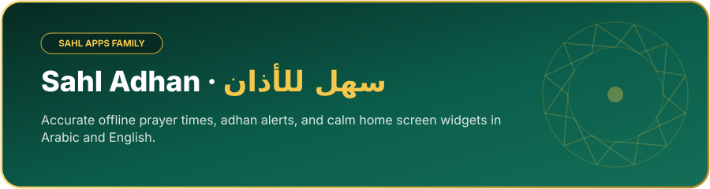

  

---

## ✨ Highlights

| Feature | What it gives you |
|---|---|
| 🕌 **3 Home Screen Widgets** | Khatmah timetable (all 6 times + countdown), compact Next Prayer card, and Today's 5-prayer strip. |
| 🧭 **Accurate Offline Times** | Calculated locally on your phone with Qatar (Awqaf) defaults, 13 cities, 6 calculation methods, and ±15 min adjustments. |
| 🔔 **Custom Adhan Alerts** | Choose Full Adhan, Short Takbir/Chime, or Off per prayer—works reliably even when the screen is locked. |
| 🌙 **Bilingual & Calm** | Arabic & English interface, Thmanyah Sans typography, light & dark emerald themes, and built-in Qibla & Ruqyah. |

---

## 📲 Install in Seconds

1. Tap **[Download Latest APK](https://github.com/AliSherif1309/SahlAdhan/releases/latest)** above.
2. Open the downloaded `.apk` file on your Android phone to install.
3. **Sahl Adhan** checks for new versions automatically so you stay up to date in one tap.

---

## 🌿 The Sahl Apps Family · عائلة تطبيقات سهل

A calm, ad-free, bilingual (**Arabic & English**) suite of everyday Android apps crafted in **Emerald & Gold**:

[🎨 Sahl Theme](https://github.com/AliSherif1309/SahlHome) · [🧭 Sahl Qibla](https://github.com/AliSherif1309/SahlQibla) · [📞 Sahl Phone](https://github.com/AliSherif1309/SahlPhone) · [👤 Sahl Contacts](https://github.com/AliSherif1309/SahlContacts) · [💬 Sahl Messages](https://github.com/AliSherif1309/SahlMessages) · [📷 Sahl Camera](https://github.com/AliSherif1309/SahlCamera) · [🖼️ Sahl Gallery](https://github.com/AliSherif1309/SahlGallery) · [📁 Sahl Files](https://github.com/AliSherif1309/SahlFiles) · [📄 Sahl PDF](https://github.com/AliSherif1309/SahlPDF) · [🛠️ Sahl Tools](https://github.com/AliSherif1309/SahlTools) · [☁️ Sahl Sync](https://github.com/AliSherif1309/SahlSync) · [📺 Sahl TV](https://github.com/AliSherif1309/SahlTV-Launcher)
